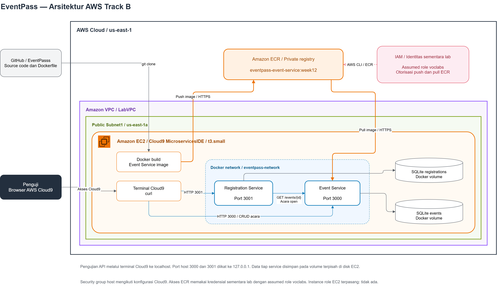

<h1 align="center">EventPass</h1>
<p align="center">
  <strong>Event Registration &amp; Ticketing System</strong><br>
  Proyek Individual Komputasi Awan · AWS Academy · Track B (Containers)
</p>

<p align="center">
  <strong>Arin Evangelica Patabang</strong><br>
  NIM 24/534030/TK/59182 · Universitas Gadjah Mada
</p>

<p align="center">
  <a href="#arsitektur">Arsitektur</a> ·
  <a href="#menjalankan-secara-lokal">Menjalankan secara lokal</a> ·
  <a href="#referensi-api">Referensi API</a> ·
  <a href="#deployment-di-aws">Deployment di AWS</a> ·
  <a href="#hasil-pengujian">Hasil pengujian</a>
</p>

---

## Ringkasan proyek

EventPass adalah REST API untuk mengelola acara dan pendaftaran peserta seminar, workshop, dan kegiatan kampus. Penyelenggara dapat membuat acara, membuka pendaftaran, memperbarui informasi, dan menghapus acara. Peserta dapat mendaftar ke acara yang terbuka. Sistem juga menyediakan daftar, detail, dan pembatalan pendaftaran.

Untuk Week 12, proyek mendemonstrasikan dua microservices dengan kontrak API dan penyimpanan terpisah, deployment container pada Amazon EC2, serta proses push dan pull image Event Service melalui Amazon ECR.

## Arsitektur



| Layanan | Tanggung jawab | Port | Database |
| --- | --- | --- | --- |
| Event Service | Mengelola data acara dan status `draft`, `open`, atau `closed`. | `3000` | `events.sqlite` |
| Registration Service | Memeriksa acara, menyimpan pendaftaran peserta, dan mencatat pembatalan. | `3001` | `registrations.sqlite` |

1. Klien mengirim `POST /registrations` dengan ID acara, nama, dan email peserta.
2. Registration Service memanggil `GET /events/{id}` ke Event Service. Di Docker, request ini melewati jaringan internal `eventpass-network` melalui `http://eventpass-events:3000`.
3. Jika acara ditemukan dan berstatus `open`, Registration Service menyimpan pendaftaran pada database miliknya dan mengembalikan `201 Created`.

Kedua layanan menggunakan modul HTTP dan SQLite bawaan Node.js 24. Di AWS, setiap container memakai Docker volume tersendiri agar data dapat digunakan kembali setelah container dimulai ulang. Kedua layanan berbagi satu host EC2, sehingga ketersediaannya bergantung pada host tersebut.

[Dokumentasi arsitektur](docs/architecture.md) · [File diagram draw.io](docs/eventpass-architecture.drawio) · [Rancangan awal Week 12](docs/week-12-design.md)

## Menjalankan secara lokal

Siapkan Git dan Node.js 24. Aplikasi memakai modul bawaan Node.js sehingga tidak memerlukan instalasi dependensi tambahan.

```powershell
git clone https://github.com/arinevangelicaa/EventPass.git
Set-Location EventPass
```

Buka dua terminal di folder proyek. Jalankan satu perintah di masing-masing terminal.

| Terminal | Perintah | Alamat |
| --- | --- | --- |
| 1 | `npm run start:events` | `http://127.0.0.1:3000` |
| 2 | `npm run start:registrations` | `http://127.0.0.1:3001` |

Periksa kedua layanan dari terminal ketiga. Masing-masing mengembalikan `200 OK` dan status `ok` ketika proses serta database siap.

```powershell
curl.exe -i http://127.0.0.1:3000/health
curl.exe -i http://127.0.0.1:3001/health
```

### Contoh membuat acara dan mendaftarkan peserta

Jalankan contoh PowerShell berikut setelah kedua layanan aktif. Contoh memakai data fiktif dan mengambil ID dari respons Event Service.

```powershell
$event = Invoke-RestMethod -Method Post -Uri 'http://127.0.0.1:3000/events' `
  -ContentType 'application/json' -Body (@{
    title = 'Workshop Komputasi Awan'
    description = 'Pengenalan Docker dan deployment container.'
    location = 'Kampus UGM'
    date = '2026-12-05T09:00:00+07:00'
    capacity = 30
    status = 'open'
  } | ConvertTo-Json)

$registration = Invoke-RestMethod -Method Post -Uri 'http://127.0.0.1:3001/registrations' `
  -ContentType 'application/json' -Body (@{
    event_id = $event.event_id
    participant_name = 'Peserta Demo'
    participant_email = 'peserta@example.com'
  } | ConvertTo-Json)

$registration
```

Respons pendaftaran memuat `registration_id`, `event_id`, nama dan email peserta, `created_at`, serta status `registered`.

## Referensi API

| Layanan | Metode | Endpoint | Fungsi | Respons sukses |
| --- | --- | --- | --- | --- |
| Keduanya | GET | `/health` | Memeriksa proses dan akses database. | `200 OK` |
| Event | POST | `/events` | Membuat acara. | `201 Created` |
| Event | GET | `/events` | Menampilkan daftar acara yang belum dihapus. | `200 OK` |
| Event | GET | `/events/{id}` | Menampilkan detail acara. | `200 OK` |
| Event | PUT | `/events/{id}` | Mengganti data acara yang dapat diedit. | `200 OK` |
| Event | DELETE | `/events/{id}` | Menandai acara terhapus dan menyembunyikannya dari daftar serta detail. | `204 No Content` |
| Registration | POST | `/registrations` | Mendaftarkan peserta ke acara berstatus `open`. | `201 Created` |
| Registration | GET | `/registrations` | Menampilkan daftar pendaftaran, termasuk yang dibatalkan. | `200 OK` |
| Registration | GET | `/registrations/{id}` | Menampilkan detail pendaftaran. | `200 OK` |
| Registration | DELETE | `/registrations/{id}` | Mengubah status pendaftaran menjadi `cancelled`. | `204 No Content` |

- **Acara.** `title`, `location`, `date`, dan `capacity` wajib diisi. `date` memakai format RFC 3339 dengan zona waktu dan disimpan dalam UTC. `capacity` harus berupa bilangan bulat positif. `description` bersifat opsional. `POST` memakai status `draft` jika field tersebut tidak dikirim. Untuk `PUT`, `status` wajib dikirim.
- **Pendaftaran.** `event_id`, `participant_name`, dan `participant_email` wajib diisi. `event_id` menggunakan UUID dari Event Service. Pembatalan mempertahankan data pendaftaran dengan status `cancelled`.
- **Kesalahan API.** Kirim body dengan `Content-Type: application/json`. Input tidak valid menghasilkan `400`, ID yang tidak ditemukan menghasilkan `404`, acara berstatus `draft` atau `closed` menghasilkan `409` saat didaftarkan, dan kegagalan menghubungi Event Service menghasilkan `503`. Detail tersedia pada `error.code` dan `error.message`.

## Deployment di AWS

| Komponen | Konfigurasi Week 12 |
| --- | --- |
| Region dan subnet | `us-east-1` (N. Virginia), LabVPC, Public Subnet1 |
| Host | Amazon EC2 `t3.small` pada Cloud9 MicroservicesIDE |
| Registry | Amazon ECR privat, repository `eventpass-event-service`, tag `week12` |
| Jaringan container | `eventpass-network` |
| Penyimpanan | `eventpass-events-data` dan `eventpass-registrations-data` |
| Akses API | `127.0.0.1:3000` dan `127.0.0.1:3001` pada host EC2 |

Source code diambil dari GitHub dan kedua image dibangun pada host EC2. Image Event Service diunggah dan ditarik kembali dari Amazon ECR menggunakan kredensial sementara lab. Registration Service dibangun dari Dockerfile dan dijalankan pada host yang sama.

### Build dan jalankan container

Jalankan perintah ini dari folder proyek pada host Linux yang sudah memiliki Docker. Pemetaan port ke `127.0.0.1` membuat API dapat diuji dari terminal host.

```bash
docker build -f services/events/Dockerfile -t eventpass-event-service:week12 .
docker build -f services/registrations/Dockerfile -t eventpass-registration-service:week12 .

docker network create eventpass-network

docker run -d \
  --name eventpass-events \
  --network eventpass-network \
  -p 127.0.0.1:3000:3000 \
  -v eventpass-events-data:/app/data \
  eventpass-event-service:week12

docker run -d \
  --name eventpass-registrations \
  --network eventpass-network \
  -p 127.0.0.1:3001:3001 \
  -e EVENT_SERVICE_URL=http://eventpass-events:3000 \
  -v eventpass-registrations-data:/app/data \
  eventpass-registration-service:week12
```

### Push dan pull image Event Service

Jalankan dari Bash setelah repository ECR tersedia dan AWS CLI menggunakan kredensial lab yang memiliki akses.

```bash
AWS_REGION=us-east-1
AWS_ACCOUNT_ID=$(aws sts get-caller-identity --query Account --output text)
REGISTRY="$AWS_ACCOUNT_ID.dkr.ecr.$AWS_REGION.amazonaws.com"
IMAGE="$REGISTRY/eventpass-event-service:week12"

aws ecr get-login-password --region "$AWS_REGION" \
  | docker login --username AWS --password-stdin "$REGISTRY"
docker tag eventpass-event-service:week12 "$IMAGE"
docker push "$IMAGE"
docker pull "$IMAGE"
```

## Hasil pengujian

| Skenario | Hasil pengujian Week 12 |
| --- | --- |
| Health check kedua layanan di EC2 | Kedua endpoint `/health` merespons `200 OK`. |
| CRUD acara di EC2 | POST `201`, GET `200`, PUT `200`, dan DELETE `204`. |
| Pendaftaran antarcontainer | Registration Service dapat memvalidasi acara dan mengembalikan `201 Created`. |
| Persistensi setelah restart | Data acara tetap tersedia setelah container Event Service dimulai ulang. |
| Distribusi image melalui ECR | Push dan pull berhasil. Container uji dari image ECR merespons `200 OK` pada port host `3002`. |

## Ruang lingkup Week 12

Versi ini berfokus pada pengelolaan acara dan pendaftaran melalui API. Kolom `capacity` menyimpan kapasitas acara sebagai informasi. Validasi kuota otomatis, pencegahan pendaftaran ganda, autentikasi, tiket QR, dan check-in berada di luar implementasi Week 12.
