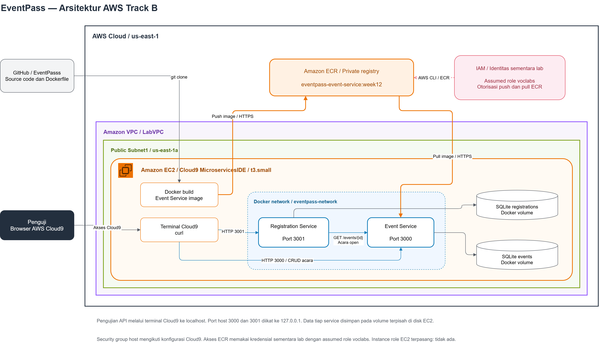
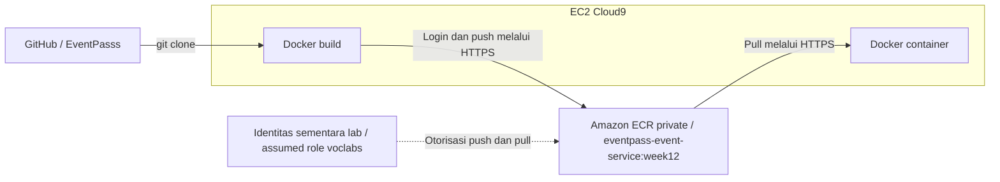

# Arsitektur EventPass

EventPass menggunakan Track B dengan Amazon EC2, Docker, dan Amazon ECR.
Dua microservices berjalan pada EC2 Cloud9 MicroservicesIDE dalam
LabVPC dan Public Subnet1 di region us-east-1.

## Diagram arsitektur AWS

[Unduh diagram yang dapat diedit](eventpass-architecture.drawio)

## Alur aplikasi dan penyimpanan

Pengujian dilakukan melalui terminal Cloud9. Event Service mengelola
CRUD acara pada localhost port 3000. Registration Service menerima
pendaftaran pada localhost port 3001.

Sebelum menyimpan pendaftaran, Registration Service memanggil
GET /events/{id} pada Event Service untuk memeriksa keberadaan acara
dan memastikan statusnya open.

Kedua container berkomunikasi melalui jaringan Docker eventpass-network.
Registration Service menggunakan alamat http://eventpass-events:3000
untuk mengakses Event Service.

Setiap service memiliki database SQLite dan Docker volume tersendiri.
Volume tersebut berada pada penyimpanan EC2. Data acara telah diuji
dan tetap tersedia setelah container dimulai ulang.

## Distribusi image dan IAM

Source code diambil dari GitHub dan dibangun menjadi Docker image
pada EC2 Cloud9. Image Event Service disimpan dalam repository privat
Amazon ECR eventpass-event-service dengan tag week12.

Login, push, dan pull image Event Service telah berhasil diuji.
Image dari ECR juga dijalankan melalui container eventpass-ecr-test
pada localhost port 3002, dengan health check menghasilkan HTTP 200 OK.

Registration Service dibangun dan dijalankan pada EC2 yang sama
menggunakan Dockerfile tersendiri.

## Infrastruktur dan keamanan

| Komponen | Konfigurasi |
|---|---|
| Region | us-east-1, N. Virginia |
| VPC | LabVPC |
| Subnet | Public Subnet1 |
| Availability Zone | us-east-1a |
| Host | EC2 Cloud9 MicroservicesIDE |
| Instance type | t3.small |
| Event Service | 127.0.0.1:3000 pada host |
| Registration Service | 127.0.0.1:3001 pada host |
| Container uji ECR | 127.0.0.1:3002 pada host |
| Jaringan antarservice | eventpass-network |
| Penyimpanan | SQLite pada Docker volume terpisah |
| Identitas AWS | Kredensial sementara lab, assumed role voclabs |
| IAM instance role terpasang | Tidak ada berdasarkan EC2 Console |

Port host aplikasi diikat ke 127.0.0.1. Pengujian API dilakukan
melalui terminal Cloud9.

Security group EC2 memiliki aturan SSH port 22 dari dua rentang IP
yang terlihat pada konfigurasi lab. Aturan lama port 8080 dan 8081
dibatasi ke satu alamat IP /32.

Akses Amazon ECR dilakukan melalui AWS CLI menggunakan identitas
sementara lab yang tersedia di Cloud9.

## Pertimbangan arsitektur

Event Service memiliki tanggung jawab mengelola acara, sedangkan
Registration Service mengelola pendaftaran peserta. Pemisahan ini
memberikan batas API dan kepemilikan data yang jelas.

Penggunaan satu EC2 menyederhanakan deployment dan pemakaian resource
untuk demonstrasi. Ketersediaan kedua service bergantung pada host
yang sama.

## Lingkungan pengerjaan

Implementasi menggunakan lab CI/CD AWS Academy yang tersedia.
Instruksi tugas menyebut AWS Learner Lab, sehingga kesesuaian
lingkungan tersebut untuk penilaian masih perlu dikonfirmasi
kepada dosen.