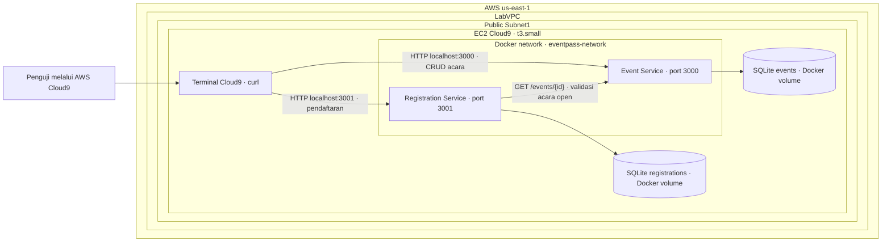
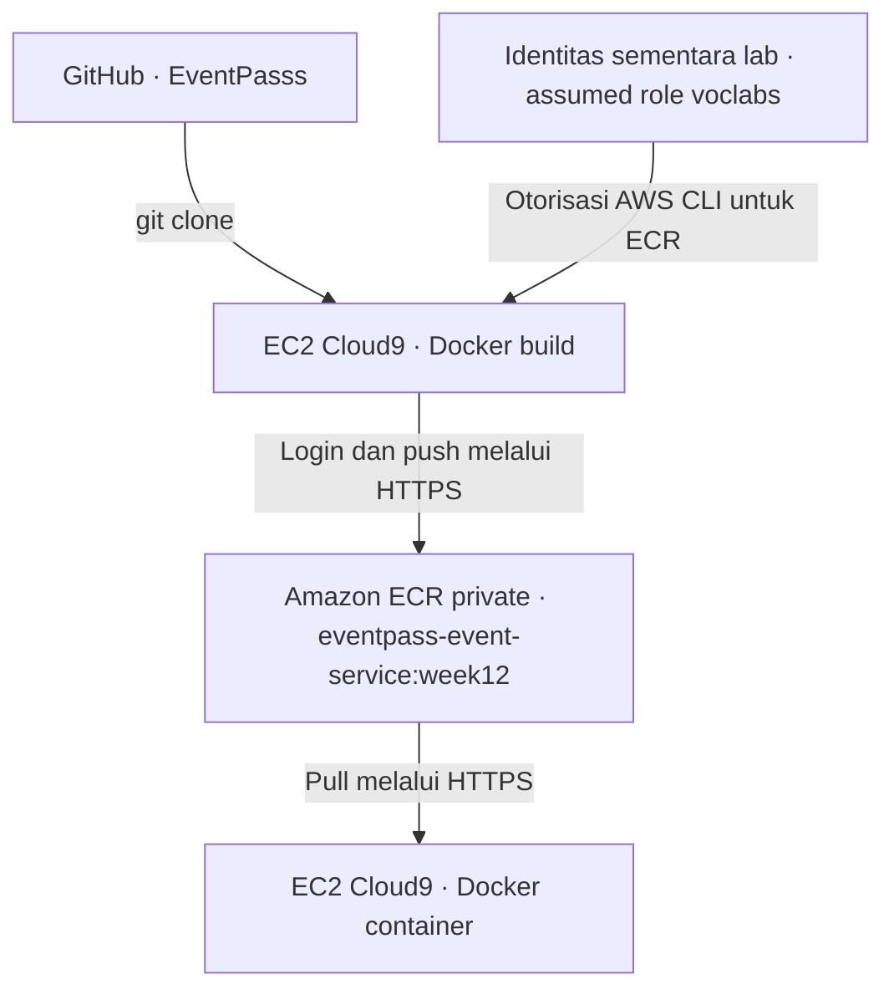

# Arsitektur EventPass

EventPass menggunakan Track B, yaitu EC2, Docker, dan Amazon ECR.
Deployment menggunakan EC2 milik environment Cloud9 MicroservicesIDE
dalam lab CI/CD AWS Academy.

## Alur aplikasi dan penyimpanan

Setiap service memiliki database dan volume sendiri pada penyimpanan
EC2. Registration Service mengakses informasi acara melalui HTTP API.

Port host 3000 dan 3001 diikat ke 127.0.0.1. Pengujian dilakukan melalui
terminal Cloud9. Kedua container berkomunikasi melalui jaringan Docker.

## Distribusi image dan IAM

EC2 tidak memiliki IAM instance role yang terpasang. Akses ECR
menggunakan identitas sementara lab yang tersedia di Cloud9.
Login, push, dan pull image Event Service telah diuji.

Security group EC2 memiliki aturan SSH port 22 dari dua rentang IP
yang terlihat pada konfigurasi lab. Aturan lama port 8080 dan 8081
dibatasi ke satu alamat IP /32. Aplikasi EventPass menggunakan
localhost port 3000 dan 3001.

Event Service dan Registration Service berjalan sebagai container
terpisah pada satu EC2. Pengujian tambahan image ECR menggunakan
container eventpass-ecr-test pada localhost port 3002.

Satu host memudahkan deployment dan penghematan resource untuk demo.
Ketersediaan kedua service bergantung pada host yang sama.

## Catatan lingkungan

Instruksi tugas menyebut AWS Learner Lab. Implementasi ini menggunakan
lab CI/CD yang tersedia. Kesesuaian lingkungan tersebut untuk penilaian
perlu dikonfirmasi kepada dosen.